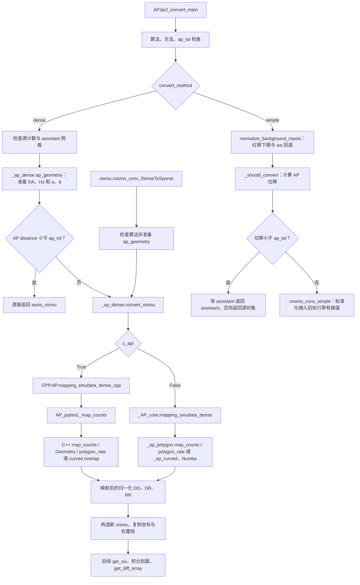

# tpCF 的 AP 转换：面积算法与程序工作链

核对日期：2026-10-18。本文以当前 `LSS_python` 活动源码为准，说明 dense AP 转换的几何、计数重分配和调用关系，以及四边形与两种曲边算法的实现、数值规则和验证。

## 1. 当前接口与实现状态

入口为 `LSS_python.AP.tpcf_convert_main`。两个选择参数的职责不同：

| 参数 | 含义 | 当前行为 |
| --- | --- | --- |
| `convert_method="dense"` | 将源网格的计数重新分配到目标网格 | 使用面积权重，是本文重点 |
| `convert_method="simple"` | 原有简单插值路径 | 保留插值内核，已统一背景输入处理并修正近基准返回值 |
| `convert_algorithm="polygon"` | dense 路径的单元重叠算法 | **默认值，C++ 与 Numba 均已实现** |
| `convert_algorithm="curved_gauss8"` | 真实曲边区域，加分段 Gauss–Legendre 八点积分 | C++ 与 Numba 均已实现 |
| `convert_algorithm="curved_analytic"` | 真实曲边区域，加分段解析积分 | C++ 与 Numba 均已实现 |
| `c_api=True / False` | 执行后端 | 分别为 C++ 和串行 Numba，不代表两种面积定义 |

`convert_algorithm` 是新增的关键字参数，已有位置参数顺序保留。未知算法名称抛出 `ValueError`。正式接口没有 `legacy` 选项；旧实现位于 `archive/ap_dense_legacy/`。

入口会先检查算法名称，再判断方法和 AP 位移。未知名称即使在基准宇宙学下也会报错。三个有效名称都能用于近基准快速返回；`simple` 也检查名称，但仍执行原有插值，名称只决定 dense 面积算法。

## 2. DA、Hz 和 AP 几何

### 2.1 背景计算与参数约定

用下标 `f` 表示源数据的 fiducial 宇宙学，用 `m` 表示待计算的 model 宇宙学。

- 两参数模型使用 `omega_m`、`w`，对应 `wa=0`。
- 三参数模型使用 `omega_m`、`w0`、`wa`；入口中的 `w_f`、`w_m` 此时表示 `w0`。
- `wa_f`、`wa_m` 默认都是 `0`；任一显式为 `None` 时，dense 与 simple 的共享输入标准化函数将两者都设为 `0`，沿用常数 `w` 回退约定。
- 输入红移要求有限且非负；dense 与 simple 路径均使用 `z_eff=max(redshift, 1e-4)`，simple 在位移判断之前就应用下限，使零红移输入避开 `DA_m/DA_f=0/0`。

`_ap_dense.ap_geometry` 调用 `base.Hz_w0wa` 和 `base.DA`，各计算 fiducial/model 两个值。当前背景为平直、物质加暗能量的 CPL 模型：

$$
E^2(z)=\Omega_m(1+z)^3+(1-\Omega_m)
(1+z)^{3(1+w_0+w_a)}\exp\!\left[-\frac{3w_a z}{1+z}\right],
$$

$$
H(z)=100E(z),\qquad
D_A(z)=\frac{c}{100(1+z)}\int_0^z\frac{dz'}{E(z')}.
$$

这里沿用库中 `h=1` 的单位约定，距离对应 `Mpc/h`。实际 `DA` 通过 `comov_dist` 的默认 1000 点梯形积分得到；后文“解析积分”指单元面积，不表示 DA 改用了解析求值。

几何准备层保存 `Hz_f, Hz_m, DA_f, DA_m`，进一步形成两个无量纲缩放因子：

$$
a\equiv\alpha_\perp=\frac{D_{A,m}}{D_{A,f}},\qquad
b\equiv\alpha_\parallel=\frac{H_f}{H_m}.
$$

两个模型在同一红移比较时，DA 与横向共动距离之比相同，共有的 `(1+z)` 因子相消。

DA、Hz 及比例必须有限且严格为正。**后续几何内核只依赖 `a,b` 和网格信息，不读取 `omega_m,w0,wa`，也不重新计算 DA、Hz。** 当前适配层仍接受历史四元组 `(Hz_f, Hz_m, DA_f, DA_m)`，进入内核前将其转成 `a,b`。

### 2.2 正变换、逆变换与曲边的来源

记源坐标为 `(r,u)=(s_f,mu_f)`，目标坐标为 `(S,v)=(s_m,mu_m)`，其中 `0<=u,v<=1`。正变换为：

$$
q(u)=\sqrt{a^2(1-u^2)+b^2u^2},\qquad
S=rq(u),\qquad v=\frac{bu}{q(u)}.
$$

逆变换为：

$$
g(v)=\sqrt{\frac{1-v^2}{a^2}+\frac{v^2}{b^2}},\qquad
r=Sg(v),\qquad u=\frac{v/b}{g(v)}.
$$

角向变换与半径无关。程序在 `r=0` 或 `S=0` 时仍使用上述角向公式，不通过 `s_parallel/(s+epsilon)` 计算角度。

源矩形单元记为：

$$
C=[r_0,r_1]\times[u_0,u_1].
$$

`u=u0,u1` 两条边在目标平面上仍是水平直线；`r=r0,r1` 两条边一般成为曲线。因此，源矩形的真实 AP 像通常是两条水平边与两条曲边围成的区域。

## 3. 三种方法共同的权重定义

将一个源格贡献给目标格 `T` 的比例记为 `rate(C,T)`。当前选用的格内均匀近似定义在**每个源格映射后的 `(S,v)` 坐标面积**上：

$$
\mathrm{rate}(C,T)=
\frac{\operatorname{Area}_{dS\,dv}(\operatorname{AP}(C)\cap T)}
     {\operatorname{Area}_{dS\,dv}(\operatorname{AP}(C))}.
$$

四边形法用四边形近似 `AP(C)`；两种曲边方法使用真实曲边区域。每种方法的分子、分母使用各自一致的几何定义。

需要区分三种“均匀”：

| 均匀假设 | 面积或体积测度 | 与本文算法的关系 |
| --- | --- | --- |
| 映射后的单元区域均匀 | `dS dv` | 当前选择 |
| 变换前源格坐标均匀 | `dr du` | 各向异性 AP 下通常得到不同的比例 |
| 三维分离空间体积均匀 | `r² dr du` 或相应目标体积元 | 另一种模型假设 |

例如正变换的二维 Jacobian 为：

$$
\frac{\partial(S,v)}{\partial(r,u)}
=q(u)\frac{dv}{du}=\frac{a^2b}{q(u)^2}.
$$

当 `a!=b` 时它依赖 `u`，所以映射后面积均匀不能直接等同于源坐标面积均匀。本文的三种算法比较始终固定同一测度，只改变边界近似或积分方式。

DD、DR、RR 使用同一组几何权重，分别累加：

$$
N^{\rm out}_{T,c}=\sum_C\mathrm{rate}(C,T)N^{\rm in}_{C,c},
\qquad c\in\{DD,DR,RR\}.
$$

分母始终是**完整源单元像的面积**，在输出范围裁剪之前计算。超出输出域的贡献直接损失，不用裁剪后的面积重新归一化。完整采用同一种 AP 几何、且目标网格覆盖某个源格的整个映射像时，对这个固定源格有 `sum_T rate(C,T)=1`；存在输出截断时可以小于 1。这是一个源格向所有目标格分配的权重和，不表示一个目标格收到的所有源格权重之和为 1。

## 4. 当前四边形法 `polygon`

### 4.1 源格四角与面积

先正变换源格的完整四个角点：

| 标号 | 源坐标 | 目标坐标 |
| --- | --- | --- |
| `p0` | `(r0,u0)` | `(r0*q(u0), v(u0))` |
| `p1` | `(r1,u0)` | `(r1*q(u0), v(u0))` |
| `p2` | `(r0,u1)` | `(r0*q(u1), v(u1))` |
| `p3` | `(r1,u1)` | `(r1*q(u1), v(u1))` |

数组存储顺序为 `p0,p1,p2,p3`，构造多边形时使用周界顺序 `p0,p1,p3,p2`，得到四边形 `Q`。这四个顶点的坐标是 AP 正变换结果，两条曲边则被端点之间的直线弦替代。

对有序多边形顶点 `x0,...,x(n-1)`，代码采用相对首点的三角剖分面积：

$$
A=\frac12\left|\sum_{k=1}^{n-2}(x_k-x_0)\times(x_{k+1}-x_0)\right|.
$$

它等价于鞋带公式，使用相对坐标可减少小单元位于大绝对坐标时的浮点抵消。

### 4.2 与目标矩形逐边裁剪

设目标格为 `T=[SL,SH]×[VL,VH]`。`polygon_rate` 先检查包围盒；没有面积交叠返回 0，源四边形完整落在目标格内返回 1。一般情形使用 Sutherland–Hodgman 裁剪，依次保留：

1. `S>=SL`；
2. `S<=SH`；
3. `v>=VL`；
4. `v<=VH`。

遍历当前多边形的每条有向边，按端点在裁剪边界的内外关系，输出保留顶点和边界交点。若裁剪坐标为 `x`、边界为 `B`，边段端点为 `P0,P1`，交点为：

$$
t=\frac{B-x(P_0)}{x(P_1)-x(P_0)},\qquad
P_{\rm cross}=P_0+t(P_1-P_0).
$$

完成四次裁剪得到交集多边形 `P`，再计算：

$$
\mathrm{rate}_{\rm polygon}=A(P)/A(Q).
$$

代码对最终比例做 `[0,1]` 截断。矩形从源四边形中间截断时，裁剪过程会插入新的交点；即使原来的四个顶点都不在目标格内，只要边穿过矩形，仍能留下正确交集。接触一条边或一个点的零面积交集贡献为 0。

因此，当前面积计算不需要旧版的 `out/scope` 分类。它精确计算直线四边形的交集面积，四边形近似与真实曲边之间的误差仍然存在。

### 4.3 候选源格搜索是独立的一步

面积算法只有在遍历到了相关源格时才能生效。当前按目标格遍历，`Geometry.candidates` 的逻辑为：

1. 将目标矩形的**完整四个角点**逆变换，取源空间的径向、角向最小值和最大值。
2. 将角向范围转成候选源角向格编号 `[j_min,j_max]`。
3. 取这些候选角向格最外侧边界上的 `q_min,q_max`，保守扩展径向范围：

   $$
   r_{\min}\leftarrow\min(r_{\min},S_L/q_{\max}),\qquad
   r_{\max}\leftarrow\max(r_{\max},S_H/q_{\min}).
   $$

4. 将范围转换为源格编号，并限制在输入数组范围内；利用 `nextafter` 使浮点边界上的候选格包含得更保守。
5. 对候选格逐个计算真实的四边形交集，过滤保守搜索带来的多余候选。

第 3 步与四边形近似有关：直线弦可能与目标格相交，即使真实曲边的逆变换边界没有给出那个候选。因此目前不能把候选搜索简化为“换成四个逆变换角点就结束”。

## 5. 两种曲边法共同的几何与分段

两种算法已接入共享库的 C++ 与 Numba dense 路径，复用现有几何、候选搜索、窗口规则和计数重建。算法名称在循环外转换为 C++ 枚举或 Numba 整数。

### 5.1 用目标角度表示真实边界

利用角向变换单调性，将源格角向边界变成 `v0=v(u0)`、`v1=v(u1)`。定义：

$$
R(v)=\frac1{g(v)}
=\frac{ab}{\sqrt{b^2+(a^2-b^2)v^2}}
=\frac{a}{\sqrt{1+\chi v^2}},\qquad
\chi=\frac{a^2}{b^2}-1.
$$

真实源格像可写成：

$$
v\in[v_0,v_1],\qquad S\in[r_0R(v),r_1R(v)].
$$

与目标格 `T=[SL,SH]×[VL,VH]` 先做角向交集：

$$
L=\max(v_0,V_L),\qquad H=\min(v_1,V_H).
$$

若 `H<=L`，交集面积为 0。否则，在固定 `v` 上的重叠宽度为：

$$
W(v)=\max\!\left(0,
\min(S_H,r_1R(v))-\max(S_L,r_0R(v))\right).
$$

两种曲边法都计算同一个比例：

$$
A_{\cap}=\int_L^H W(v)\,dv,\qquad
A_{\rm full}=(r_1-r_0)\int_{v_0}^{v_1}R(v)\,dv,
\qquad\mathrm{rate}_{\rm curved}=A_{\cap}/A_{\rm full}.
$$

这样，二维曲边区域的面积被化为一维积分。

### 5.2 找齐边界交点，再确定每段表达式

`W(v)` 含有 `min/max`，直接跨越其转折点积分会降低数值精度。要查找每一条曲边与每一条目标径向边的交点：

$$
rR(v)=S_*,\qquad
r\in\{r_0,r_1\},\quad S_*\in\{S_L,S_H\}.
$$

当 `r>0`、`S_*>0`、`chi!=0` 时：

$$
v^2=\frac{(ar/S_*)^2-1}{\chi}.
$$

只保留物理范围内且位于 `(L,H)` 的实根。加入 `L,H`，排序、去重，得到若干子区间。`r=0`、`S_*=0`、各向同性或边界重合的情形应独立处理，避免在求根公式中除以零。

每个子区间内部不再发生边界分支切换，在中点判断当前上下边界由哪一项提供，就能写成：

$$
W(v)=cR(v)+d
$$

或者整段为 0。例如上下边都取源曲边时 `c=r1-r0,d=0`；上下边都取目标矩形边时 `c=0,d=SH-SL`；一侧由曲边、另一侧由矩形边提供时得到相应混合项。

## 6. 曲边加 Gauss8 积分 `curved_gauss8`

Gauss8 保留上述真实曲边，对每个已分段区间 `[l,h]` 采用八点 Gauss–Legendre 积分。令 `xk,wk` 为标准区间 `[-1,1]` 上的节点和权重，则：

$$
\int_l^h f(v)\,dv\approx
\frac{h-l}{2}\sum_{k=1}^8w_k
f\!\left(\frac{l+h}{2}+\frac{h-l}{2}x_k\right).
$$

实现存储四个正节点及其权重，成对求值 `+xk`、`-xk`。一般曲边情况下，分子直接积分非负宽度 `W(v)`，分母数值积分 `R(v)`，不借用解析原函数。严格 `a==b` 时两端共同采用常数退化分支：`R(v)=a`，分子为角向交集长度乘径向交集宽度，分母为 `(r1-r0)*a*(v1-v0)`。这是常数矩形的直接面积，不是求积失败后的算法回退。每个源角向格的完整面积只预计算一次，候选格循环内复用。

关键步骤是**先分段，再用八点公式积分**。八个点是在每个平滑子区间内取点，不是在整个未分段单元上只取八个点，也不是把源格均匀拆成八份。

每段先求一个整段 Gauss8 值，再求左右半段之和。若两者差大于内部相对目标 `1e-12`，继续二分，子段复用已经计算的半段值；最大二分深度为 24。C++ 和 Numba 均使用固定容量显式栈，先压右段再压左段，从左到右累加接受的子区间；C++ 不再采用递归子树求和。精度参数不对外公开。

在径向边接近重合时，`min/max` 中的大坐标相减有浮点舍入噪声。收敛判断同时采用 `16*eps*radial_scale*(h-l)` 的可表示误差下限；两端统一取 `qmax=max(R(l),R(h),R(mid))`，分子尺度为 `max(abs(r0*qmax),abs(r1*qmax),abs(SL),abs(SH))`，分母尺度为 `qmax`。数学上端点已足够，但浮点求值不一定严格保持单调，因此共同保留中点样本。这个下限只用于判断继续二分能否提高精度，不向面积或分母添加小量。区间达到深度上限仍不收敛时抛出 `RuntimeError`，不切换算法。C++ 在 OpenMP 循环内记录异常、在线程外报告。

若区间窄到中点与某个端点是同一个浮点数，则不构造虚假的二分。两端用该已分段单调被积函数的端点变化量乘区间长度，检查已有整段 Gauss8 估计是否满足同一相对目标/舍入噪声尺度；能确认时接受已有估计，否则明确报错，不切换方法。

该方法消除了直线弦近似，但自适应误差估计不是对任意病态输入的严格误差证明。验证采用独立求根及高精度积分，并与解析法对照。

## 7. 曲边加解析积分 `curved_analytic`

这一方法与 Gauss8 使用同样的曲边、交点和区间分支，区别在于用 `R` 的原函数计算区间积分。设 `F'(v)=R(v)`：

$$
F(v)=
\begin{cases}
\dfrac{a}{\sqrt{\chi}}\operatorname{asinh}(\sqrt{\chi}\,v),&\chi>0\quad(a>b),\\[6pt]
\dfrac{a}{\sqrt{-\chi}}\arcsin(\sqrt{-\chi}\,v),&\chi<0\quad(a<b),\\[6pt]
av,&\chi=0\quad(a=b).
\end{cases}
$$

每个子区间的交集面积直接为：

$$
\int_l^h W(v)\,dv=c[F(h)-F(l)]+d(h-l),
$$

并以 `(r1-r0)[F(v1)-F(v0)]` 作为完整源格面积。

实现采用以下稳定性处理：

- `abs(chi)<1e-8` 时使用近各向同性的二阶展开，幂差提出 `(h-l)` 因子，避免窄区间消减：

  $$
  \int_l^h R(v)\,dv\approx a\left[(h-l)-\frac{\chi}{6}(h^3-l^3)
  +\frac{3\chi^2}{40}(h^5-l^5)\right].
  $$

- 其他区间用 `asinh` 差恒等式或 `atan2` 表达的 `asin` 差；差式中的端点差直接使用 `sqrt(abs(chi))*(h-l)`，并用 `hypot`、因式分解的平方根控制舍入。
- 交点使用固定六元素缓冲区（两个端点加四个可能交点），排序后跳过零宽区间。仅在严格 `a=b` 时不求交点，不用固定“小各向异性阈值”丢弃交点。零半径边不参与除法求根。
- Gauss8 与解析法在两端分别共用同一个分段循环：先跳过 `h<=l` 的零宽区间，再由中点判断有效宽度及 `c,d` 分支；空段不进入求积。这个判断依赖已经列齐所有径向交点，每段内部不再切换宽度分支，不引入小面积截断阈值。检查完整源格分母严格为正且有限、交集面积及最终比例有限。比例超出 `[0,1]` 超过 `1e-10` 时明确报错，仅在这个边界误差范围内截断，不做面积正则化。
- `a=b` 时 `R(v)=a`，曲边退化成直边，三种方法应一致。

“解析”表示在选定的格内面积测度、AP 变换和浮点数运算下解析求面积；格内均匀近似及 DA 数值积分误差仍然存在。

### 三种方法的比较

| 方法 | 源格边界 | 交集求值 | 主要误差来源 |
| --- | --- | --- | --- |
| `polygon` | 四角之间的直线 | 矩形裁剪与多边形面积 | 曲边被直线弦替代，另有浮点误差 |
| `curved_gauss8` | 真实 AP 曲边 | 交点分段后八点积分 | 数值求积与浮点误差 |
| `curved_analytic` | 真实 AP 曲边 | 交点分段后原函数差 | 浮点误差及近退化情形的数值处理 |

此前真实 AP 单元的例子如下，编号为训练数组的零起始索引；表中数值是**单个源格向一个目标格分配的比例**：

| 样本与切片 | 旧算法 | 四边形法 | 曲边面积比例，约 |
| --- | ---: | ---: | ---: |
| index 4947，snap83，原 `out=2, scope=0` | 0 | 0.9999160813 | 0.9999158265 |
| index 1572，snap83，原 `out=1, scope=-1` | 1 | 0.6826601954 | 0.6826054501 |

第二个例子的源格 `[450,558]` 还向相邻目标格 `[38,104]` 分配约 `0.3173398046` 的四边形权重。旧搜索曾漏掉该贡献，说明**候选搜索与面积算法都必须正确**。四边形法与曲边法之间的小差别，则来自边界近似。

## 8. 从 `tpcf_convert_main` 开始的当前工作链



### 8.1 高层入口与直接对象方法

高层 dense 路径要求 `assis_xismu`，目标尺寸来自它的 `(sbin,mubin)`，源与 assistant 必须有相同的正 `smax`。输入计数及归一化常数也会被检查。

AP 位移定义为：

$$
d_{\rm AP}=\sqrt{(a-1)^2+(b-1)^2}.
$$

当 `d_AP<ap_tol` 时直接返回 **assistant 本身**，不是复制对象或先重新分箱。`ap_tol` 默认 `1e-5`；设为 `0` 可强制执行计数映射，包括恒等 AP 的重分箱。

当前高层调用的是 `ap_geometry -> convert_xismu`，**没有再调用对象方法** `cosmo_conv_DenseToSparse`，以避免重复计算背景。直接使用该对象方法则是另一条入口，它准备几何后进入同一个 `convert_xismu`，不带高层 `ap_tol` 快速返回。直接方法仍允许不提供 `assistant_xismu`，显式指定 `sbin2,mubin2`，默认目标尺寸为 `150×120`。

两条入口的参数别名对应为：`omega_mf,w_f,omega_mm,w_m,wa_f,wa_m` 对应 `omstd,wstd,omwrong,wwrong,wastd,wawrong`。

### 8.2 数据、网格与后端

`xismu.DD/DR/RR` 在对象内部已经除以各自的归一化常数。`convert_xismu` 将它们叠为形状 `(source_s,source_mu,3)` 的数组，传给后端。

高层按均匀网格 `[0,smax]×[0,1]` 生成几何边界；assistant 的 `S/Mu` 用作返回对象的坐标。源计数和 assistant 应对应这些均匀分箱，不能把任意非均匀坐标数组当成后端的分箱边界。底层接口另可显式传入非零的径向下界及部分角向范围。

C++ 与 Numba 适配层共同检查形状、范围、有限值，并将历史背景四元组转为比例。输入转为连续 `float64` 数组。C++ 绑定分配独立输出数组并释放 GIL；内核按目标格累加，每个输出格由一个线程负责。`CPP.AP.mapping_smudata_dense_cpp` 的 `nthreads` 默认是 `1`；高层目前未新增该线程参数。MPI 是外层扫描方式，不在单次转换函数内部启动。

### 8.3 映射窗口与输出范围

高层默认映射窗口是 `[3,60]×[0,1]`。对于目标格 `[SL,SH]×[VL,VH]` 和窗口 `[WL,WH]×[UL,UH]`，当前内核采用包含接触边界的重叠判定：

```text
active = SH >= WL and SL <= WH and VH >= UL and VL <= UH
```

选中时，整个目标格使用 AP 几何；未选中时，整个目标格使用恒等几何做面积重分箱。窗口不是对源格或目标格再做一次局部裁剪，目标格仅与窗口接触时也会被选中。上下限相等时，接触该位置的格仍可能被选中。

混合 AP 与恒等几何的区域边界处，同一个源格可能同时向两种区域贡献，因此不能对这种混合结果直接要求全域计数守恒。几何权重守恒的验证应选完整 AP 窗口，并单独核对输出域截断。

### 8.4 结果重建与后续统计

后端返回归一化计数后，`convert_xismu` 乘回原 `DDnorm/DRnorm/RRnorm`，再交给 `xismu` 构造器；构造器会除以这些常数，因此返回对象内部仍保存归一化计数。

新对象保留原归一化常数及 `sum_wd,sum_wr,sum_wd2,sum_wr2`。提供 assistant 时复制其 `S/Mu`，否则生成目标格中心坐标；`s_array,mu_array` 据此建立。`xis` 初始仍为 `None`，后续 `get_xis()` 按需计算：

$$
\xi=(DD-2DR+RR)/RR.
$$

因此 AP 转换作用于三类计数，之后才计算相关函数。现有构造器仍将零 RR 替换为 `1e-15`；临时诊断属性已经从活动实现中删除。

`get_diff_array` 在后续完成剖面积分、各切片归一化及切片相减。当前默认平滑正则化对剖面 `X` 使用：

$$
m=\operatorname{mean}(X),\quad\sigma=\operatorname{std}(X),\quad
d=\sqrt{m^2+(\eta\sigma)^2},\quad
X_{\rm norm}=1+(X-m)/d,\qquad\eta=0.2.
$$

原始均值归一化可通过 `norm_method=None` 选择。零 RR、几何漏算和剖面均值接近零属于不同环节的问题；更正确的 AP 面积算法不保证相关函数剖面的均值远离零。

### 调用示例

```python
from LSS_python.AP import tpcf_convert_main

converted = tpcf_convert_main(
    dense_xismu,
    omega_mf=0.3111, w_f=-1.0,
    omega_mm=0.30, w_m=-0.9,
    redshift=0.8,
    assis_xismu=assistant_xismu,
    wa_f=0.0, wa_m=0.2,
    smin_mapping=3.0, smax_mapping=60.0,
    c_api=True, ap_tol=1e-5,
    convert_algorithm="polygon",
)
xi = converted.get_xis()
```

将示例算法名称改为 `curved_gauss8` 或 `curved_analytic` 即可使用对应曲边内核，`c_api` 同样选择 C++ 或 Numba。

### 8.5 simple 分支的审查修正（2026-10-18）

针对审查发现的返回值和背景输入不一致，已完成以下处理：

| 场景 | 原行为 | 修正后行为 |
| --- | --- | --- |
| `simple` 的 AP 位移小于 `ap_tol`，没有 assistant | 返回默认值 `None` | 返回输入 `xismu` 本身 |
| 同上，但提供了 assistant | 返回 assistant | 保持返回 assistant 本身 |
| `redshift=0` | 位移判断先算 DA 比值，产生 `0/0` | 判断前使用 `1e-4`；实际插值使用同一有效红移 |
| 任一 `wa=None` | 判断阶段回退常数 w，但后续可能将 None 传入 Numba | 判断与插值均将两侧 wa 设为 `0` |
| 直接调用 `xismu.cosmo_conv_simple` | wa 回退缺失，红移验证不完整 | 使用相同的输入标准化规则 |

共享规则位于 `_ap_dense.normalize_background_inputs`，由 dense 的 `ap_geometry`、simple 高层分支及其直接对象方法调用。它检查宇宙学输入有限性和红移非负性，并返回统一的有效红移、`wa_f`、`wa_m`。

simple 的小位移返回采用对象复用，不复制对象；调用者修改返回对象时会影响对应的源对象或 assistant。设置 `ap_tol=0` 时，即使模型与基准相同，高层也会进入插值路径。

本次保留 `_AP_core.mapping_smudata_to_another_cosmology_simple -> simple_core` 的原有双线性插值及计数重建。simple 高层仍先计算背景判断位移，需要转换时对象方法再按相同参数计算背景；它没有改用 dense 的四边形内核。dense 的一次几何准备和计数映射结构不变，PS 使用的 `_ap_convert_factors`、`_should_convert` 也未全局改写。

针对性验证覆盖近基准返回的对象身份、零红移与显式 `1e-4` 的一致性、两侧及单侧 `wa=None` 与常数 w 的一致性，以及无效红移的报错；高层入口和直接对象方法分别检查。测试位于 `tests/test_ap_polygon.py` 中的 `test_simple_*`。

本次相关检查共 60 项通过，包含 16 项新增 simple 边界用例及既有四边形/Numba 一致性检查。另以常数 w、非零 wa 两组普通参数对照归档旧 simple 实现，DD/DR/RR 逐项一致，最大绝对差为 0。

## 9. 曲边实现与验证

两种曲边方法与 polygon 共用 DA/Hz 准备、网格检查、四角逆变换及径向保守扩展、映射窗口、DD/DR/RR 累加和对象重建。C++ 曲边遍历位于 `AP_curved.hpp`，Numba 复用 `_ap_polygon.map_counts` 的遍历；polygon 分支保留原有运算顺序。曲边完整面积使用实际源角向边界预计算，支持非零径向下界和部分角向范围。输出截断后不重新归一化；窗口外继续恒等重分箱。

独立参考位于 `tests/test_ap_curved.py`：枚举全部源格和目标格，不使用生产候选搜索；用 `brentq` 独立寻找曲边与径向边的交点，再用 SciPy 自适应积分计算 `W(v)` 及完整源格面积。单元权重绝对误差目标为 `1e-10`，整幅映射对照使用 `rtol=1e-10, atol=1e-12`。

覆盖各向同性、`1e-12` 量级的近各向同性、粗细网格、`s=0`、中间截断、四顶点均在目标格外、跨格、非零径向下界、部分角向网格和窗口、输出截断。另检查适用条件下的计数守恒、C++/Numba 一致性、C++ 单线程/双线程逐元素一致性、`ap_tol=0` 强制进入三种内核，以及 Gauss8 无法收敛时明确报错。原有 polygon 和 simple 测试保留。

代表点运行器为 `tests/validate_ap_curved.py`，无参数显示帮助。它从历史诊断中选取两参数 tpCF、两参数和三参数 `weipow=-1 refit_fix` 的三个红移对，包含普通点、已知异常点和每个切片实际训练 AP 比例的极值。比较归一化 DD/DR/RR、统计向量及固定 precision 下的原始卡方，不训练 PCA。耗时只计入两个切片的完整 `tpcf_convert_main` 调用（含背景准备、面积映射和对象重建），排除数据加载、统计量及卡方计算；每种情况预热后交错测量。

```sh
PYTHONPATH=src python -m pytest -q tests/test_ap_polygon.py tests/test_ap_cpp.py tests/test_ap_curved.py
PYTHONPATH=src python tests/validate_ap_curved.py --run \
  --project /mnt/xiaodong/xiaoliang/JT-2G/cov_bias_test \
  --output /tmp/ap-curved-validation --repeats 5
```

本轮不覆盖既有科学结果、PCA 模型或生产缓存，不恢复临时诊断属性。整批训练点的卡方及 PCA 影响另行计算。

### 9.1 首次接入时的验证结果（双端统一前，2026-10-18）

实际共享库位置运行上述回归测试：**100 项通过**。替换前后另选八组 C++/Numba polygon 映射逐元素对照，全部位级一致。以 12 组随机 AP 比例、每组 6 个独立源格进行额外枚举积分核对，共 72 幅单源格映射/算法，最大权重绝对误差为 Gauss8 `3.56e-15`、解析法 `4.67e-15`。这些误差是本次样本的实测值。

代表点检查共 **71 个红移对/参数点组合**，每点执行两个后端和三种算法，覆盖实际 a、b 及 a/b 极值、最近基准点、首中尾训练点与三个已知异常索引。固定各数据集原有 target 和 precision，不重新拟合 PCA。下表为解析曲边法相对 polygon 的最大卡方绝对变化：

| 数据 | 83_97 | 88_108 | 94_118 |
| --- | ---: | ---: | ---: |
| 两参数 tpCF | 9.4780539e-06 | 5.2968643e-05 | 7.9808748e-05 |
| 两参数 MCF，weipow=-1 refit_fix | 0.00014262587 | 0.00078247802 | 0.00080627206 |
| 三参数 MCF，weipow=-1 refit_fix | 0.049215442 | 0.42035289 | 0.019862723 |

两种曲边法的最大统计向量绝对差为 `1.039e-13`，最大卡方绝对差为 `2.4011e-10`。所有代表点的 C++/Numba 统计向量逐元素相同；计数数组也通过 `rtol=1e-10, atol=1e-12` 的一致性检查。上述最大值仅针对所选代表点，不能代替整批训练/PCA 评估。

以下耗时为 9 个数据/红移对、每组普通点和 AP 极端点，共 18 种情况的耗时中位数再取中位数；每种情况预热后测 5 次。单次包含两个切片完整转换，C++ 为单线程，Numba 为串行。

| 后端 | polygon，秒 | curved_gauss8，秒 | curved_analytic，秒 |
| --- | ---: | ---: | ---: |
| cpp | 0.08489 | 0.31666 | 0.14936 |
| numba | 0.34048 | 0.55674 | 0.32315 |

按同一情况计算相对 polygon 的耗时比后取中位数，C++ 为 Gauss8 `3.67` 倍、解析法 `1.69` 倍；Numba 为 Gauss8 `1.63` 倍、解析法 `0.956` 倍。此为本机代表点完整调用耗时，包含固定开销，不是孤立面积函数的速度。

本轮结果保存在工作区独立目录：

```text
/mnt/xiaodong/xiaoliang/JT-2G/cov_bias_test/diagnostics/ap_curved_validation_20261018_final
    REPORT.md       # Count, statistic, chi-square and timing tables
    summary.json    # Parameters, factors, checksums and full timings
    vectors.npz     # Three algorithms and both backends at all selected points
```

没有改写已有科学结果、PCA 模型或生产缓存；未引入临时诊断属性。

### 9.2 C++/Numba 双端统一（2026-10-18）

两端统一采用以下数值规则：

1. 严格 `a==b` 时，面积内核直接返回 `R=a`，两种曲边算法的分子和完整源格分母均使用矩形常数面积，避免通过 `hypot` 或多个求积节点引入额外舍入。仅严格相等进入此分支，不把近各向同性点合并进去。
2. 两种积分策略在各自后端共用同一交点分段循环：先跳过零宽段，再按分段后的中点宽度跳过空段。根的排序、重复交点及零半径规则一致，没有新增小面积截断阈值。
3. 分子和分母统一使用端点加中点的 `R` 最大值确定舍入噪声尺度；相对目标仍为 `1e-12`，最大二分深度仍为 24。
4. 两端采用相同的固定容量显式栈、先压右段再压左段、从左到右累加接受子区间，并复用已求得的半段值。对于不存在内部浮点中点的区间，共用端点变化界的可分辨性检查；未满足误差要求时明确报错。

安装位置回归共 **124 项通过**，其中新增 24 项覆盖非单位各向同性缩放、偏离相等值一个浮点单位、近各向同性展开切换边界、相邻浮点端点、重复交点和需要自适应细分的强各向异性粗网格。独立的矩形交集或 SciPy 求根/积分作为参考。

另外保存了 12 组比例、两个后端和三个算法的小网格替换前后对照：24 项 polygon 映射全部逐元素不变；两种曲边算法的最大变化为 `4.4409e-16`。六组严格各向同性缩放下，两个曲边算法和两个后端的结果在这些用例中逐元素一致。

重新执行全部 **71 个代表红移对/参数组合**，两个后端、三个算法共 **426 个统计向量**，与第 9.1 节保存的统一前向量全部逐元素相同，最大绝对变化为 0。两端计数和统计向量也继续通过一致性检查。这里记录本机用例的实测一致性，不承诺任意平台、任意输入逐位相同。

本轮同样测量 18 种普通/极端参数情况，预热后每种情况测 3 次，以下是各情况中位耗时再取中位数；单次仍是两个切片的完整转换：

| 后端 | polygon，秒 | curved_gauss8，秒 | curved_analytic，秒 |
| --- | ---: | ---: | ---: |
| cpp | 0.08118 | 0.33911 | 0.14347 |
| numba | 0.33270 | 0.55962 | 0.32319 |

本轮与第 9.1 节为独立计时，测量次数也不同，不将两表差值直接归因为代码改动。结果和小网格前后数组保存在：

```text
/mnt/xiaodong/xiaoliang/JT-2G/cov_bias_test/diagnostics/ap_curved_backend_unification_20261018
    REPORT.md
    summary.json
    vectors.npz
    kernel_before.npz
    kernel_after.npz
```

本轮只重建 AP 扩展，未改变公开参数、polygon 默认值或 simple 路径；没有覆盖既有科学结果、PCA 模型或生产缓存，也未恢复临时诊断属性。

## 10. 源码与原型位置

共享库内的相对路径：

| 文件 | 主要职责 |
| --- | --- |
| [AP.py](../src/LSS_python/AP.py) | `tpcf_convert_main`、方法分支与高层近基准判断 |
| [_ap_dense.py](../src/LSS_python/_ap_dense.py) | 算法检查、共享背景输入标准化、dense 背景准备、输入验证和结果重建 |
| [base.py](../src/LSS_python/base.py) | `Hz_w0wa`、`DA`、`comov_dist` |
| [tpcf.py](../src/LSS_python/tpcf.py) | `xismu`、直接转换入口、相关函数与后续统计 |
| [CPP/AP.py](../src/LSS_python/CPP/AP.py) | 历史四元组到比例内核的 C++ 适配 |
| [CPP/src/AP_pybind.cpp](../src/LSS_python/CPP/src/AP_pybind.cpp) | 数组绑定、校验和 GIL 管理 |
| [CPP/src/AP.hpp](../src/LSS_python/CPP/src/AP.hpp) | C++ 目标格遍历、窗口判断与计数累加 |
| [CPP/src/AP_polygon.hpp](../src/LSS_python/CPP/src/AP_polygon.hpp) | 候选格搜索、正逆几何、四边形裁剪 |
| [_AP_core.py](../src/LSS_python/_AP_core.py)、[_ap_polygon.py](../src/LSS_python/_ap_polygon.py) | Numba 适配、共用遍历与四边形实现 |
| [CPP/src/AP_curved.hpp](../src/LSS_python/CPP/src/AP_curved.hpp)、[_ap_curved.py](../src/LSS_python/_ap_curved.py) | 曲边几何、交点、Gauss8 与解析积分、源格面积缓存 |
| [archive/ap_dense_legacy/README.md](../archive/ap_dense_legacy/README.md) | 旧算法归档及隔离复现方法 |

此前曲边面积及单元例子位于当前工作区的：

```text
JT-2G/cov_bias_test/outputs.bak/diagnostics/snap83_97-ap-benchmark/
    overlap.hpp
    mapping_curved_gauss.inc
    mapping_curved_analytic.inc
    example4947_geometry.json
    example1572_geometry.json
    explain_cell.py
```

其中 `overlap.hpp` 的 `CurvedContext` 提供共同曲边表达式、交点分段、Gauss8 与稳定解析积分。`mapping_curved_*.inc` 是基准测试原型，仍包含旧遍历结构，不能作为当前生产调用链直接整体替换；本轮只借鉴几何定义，重新实现数值内核并接入当前完整搜索框架。
